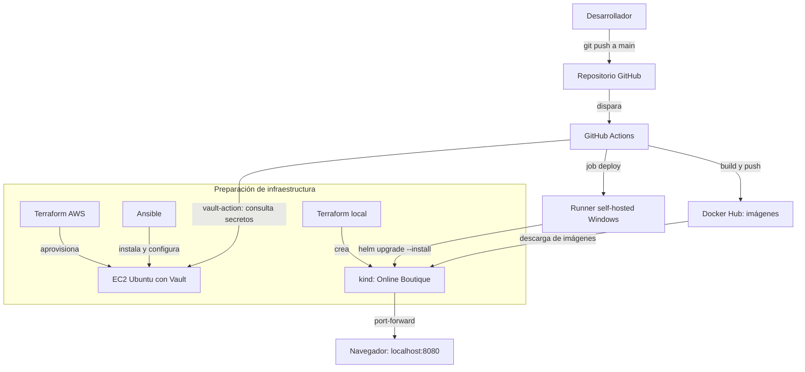

# Online Boutique — Proyecto Integrador DevOps (Fases I–IV)

**Infraestructura reproducible, integración y despliegue continuo y administración centralizada de secretos** para una aplicación demostrativa de comercio electrónico.

**Proyecto académico:** Proyecto Integrador de la Metodología DevOps · **Aplicación base:** [Google Cloud Online Boutique](https://github.com/GoogleCloudPlatform/microservices-demo) · **Repositorio de trabajo:** [ProyectoDevOps](https://github.com/AlejandroVela333/ProyectoDevOps)

> **Alcance:** entorno de laboratorio, no despliegue de producción. Online Boutique es una aplicación de referencia de Google Cloud; el trabajo académico se centra en automatizar su infraestructura, construcción, distribución y operación.

## El problema

Desplegar una aplicación compuesta por múltiples servicios mediante instrucciones manuales implica pasos repetitivos, posibles diferencias entre entornos y mayor dificultad para comprobar qué configuración se utilizó. También resulta arriesgado gestionar credenciales de publicación directamente en el código o repartirlas entre varias herramientas.

En este proyecto académico se estudian esos riesgos mediante Online Boutique. **No se atribuyen métricas de pérdidas o incidentes a una empresa real**: se plantea un escenario representativo para evaluar el valor de DevOps.

## La propuesta (Fase I)

Definir un proceso versionado y repetible para que un cambio en el repositorio pueda construirse, publicarse y desplegarse mediante herramientas coordinadas. Los beneficios **buscados** son:

- **Trazabilidad:** registrar cambios de configuración y código con Git y GitHub.
- **Menos pasos manuales:** automatizar compilación de imágenes, publicación y despliegue con GitHub Actions, Docker y Helm.
- **Infraestructura como código:** definir el clúster local y la instancia AWS con Terraform.
- **Configuración consistente:** instalar y configurar Vault con Ansible.
- **Control de secretos:** almacenar las credenciales de Docker Hub en Vault y permitir al pipeline solo la lectura necesaria.

Los resultados medidos y sus límites se presentan más adelante; estos beneficios no deben confundirse con ahorros económicos demostrados.

## La aplicación

Online Boutique simula una tienda en línea con catálogo, carrito, proceso de compra, recomendaciones, envíos y pagos de prueba. Su documentación base describe **11 microservicios en cinco lenguajes**. Nuestro workflow construye **12 imágenes** porque también incluye `shoppingassistantservice` en su matriz; el número de imágenes del pipeline no debe confundirse con el recuento de servicios de la descripción base. El chart de Helm actual mantiene `shoppingAssistantService.create: false` y señala que ese servicio todavía no está disponible en el chart, por lo que construir su imagen no implica que Helm lo despliegue.

## Arquitectura

La **instancia EC2 con Vault** se ejecuta en AWS Academy Learner Lab. El **clúster Kubernetes kind** y el **runner self-hosted** funcionan en el equipo local con Windows/Docker Desktop. Los trabajos de construcción corren en runners administrados de GitHub (`ubuntu-latest`).



**Secuencia:** Terraform aprovisiona infraestructura; Ansible prepara Vault; el pipeline consulta credenciales de Vault, construye y publica imágenes en Docker Hub; el runner local ejecuta Helm en kind; finalmente se comprueba la tienda en el navegador. La preparación de infraestructura **no se ejecuta necesariamente en cada push**.

## Tecnologías usadas

| Herramienta | Función en este proyecto |
|---|---|
| Git / GitHub | Código y cambios versionados |
| Terraform (AWS) | EC2 Ubuntu, registro de llave pública SSH, grupo de seguridad y salida IP |
| Terraform (kind) | Clúster Kubernetes local |
| Docker / Docker Hub | Construcción y registro de imágenes |
| GitHub Actions | Automatización del flujo CI/CD |
| Runner self-hosted (Windows) | Ejecuta Helm con acceso al clúster local |
| Helm / Kubernetes kind | Instalación y actualización de microservicios |
| Ansible | Instalación, configuración y arranque de Vault |
| HashiCorp Vault | Secretos KV v2, políticas y tokens |

## Cómo funciona

### Infraestructura: Terraform

**Archivos:** [`terraform_aws/main.tf`](terraform_aws/main.tf) y [`terraform-local/main.tf`](terraform-local/main.tf).

El primer archivo declara la región `us-east-1`, una AMI Ubuntu 24.04, una instancia `t3.micro`, el registro en AWS de una llave pública SSH local y un grupo de seguridad para el laboratorio. Expone la IP de la máquina como salida:

```hcl
resource "aws_instance" "vault" {
  ami                    = data.aws_ami.ubuntu.id
  instance_type          = "t3.micro"
  key_name               = aws_key_pair.llave.key_name
  vpc_security_group_ids = [aws_security_group.vault.id]
}

output "ip_publica" {
  value = aws_instance.vault.public_ip
}
```

El segundo archivo declara el clúster local:

```hcl
resource "kind_cluster" "online_boutique" {
  name = "online-boutique"
}
```

**Por qué existe:** permite revisar y reproducir los recursos declarados, en lugar de reconstruirlos manualmente desde interfaces gráficas. **Sin él:** se pierde una definición versionada del entorno y aumenta la dependencia de instrucciones manuales. `terraform apply` administra recursos según el estado y la configuración: **no debe ejecutarse sin revisar antes el plan**.

> **Consideración de seguridad:** en el ejemplo académico, `terraform_aws/main.tf` permite entrada a los puertos 22 y 8200 desde `0.0.0.0/0`, y el listener de Vault tiene TLS deshabilitado. Esta configuración **no es apropiada para producción**. Para una implementación real, restringir orígenes, exigir TLS y revisar la política de acceso.

### Pipeline CI/CD: GitHub Actions, Docker Hub y Helm

**Archivos:** [`.github/workflows/ci-build.yml`](.github/workflows/ci-build.yml), [`.github/workflows/vault-demo.yml`](.github/workflows/vault-demo.yml) y [`helm-chart/`](helm-chart/).

1. Un **push a `main`** activa `CI/CD - Build, Push and Deploy`.
2. La matriz del job `build-and-push` construye **12 imágenes** en runners `ubuntu-latest`.
3. Cada trabajo consulta credenciales de Docker Hub mediante `hashicorp/vault-action@v4` y publica su imagen `:latest`.
4. El job `deploy` espera que termine `build-and-push` (`needs: build-and-push`).
5. Un runner `self-hosted` con acceso al clúster local ejecuta Helm.

Fragmento relevante de `ci-build.yml` (la versión del repositorio usa `vault-action@v4`):

```yaml
- name: Pedir credenciales de Docker Hub a Vault
  uses: hashicorp/vault-action@v4
  with:
    url: ${{ vars.VAULT_ADDR }}
    token: ${{ secrets.VAULT_TOKEN }}
    secrets: |
      secret/data/online-boutique/dockerhub username | DOCKERHUB_USERNAME ;
      secret/data/online-boutique/dockerhub token | DOCKERHUB_TOKEN
```

Despliegue definido en el mismo workflow:

```bash
helm upgrade --install online-boutique ./helm-chart --set images.repository=USUARIO_DOCKERHUB --set images.tag=latest
```

En el workflow, `USUARIO_DOCKERHUB` se obtiene de Vault como variable de entorno, no se escribe como credencial literal. El archivo `vault-demo.yml` permite ejecutar manualmente una prueba acotada de consulta de secretos y autenticación con Docker Hub antes de probar el pipeline completo.

**Por qué existe:** conecta la publicación de cambios con la generación y entrega de imágenes. **Sin él:** cada etapa exigiría intervención manual y sería más difícil reproducir el proceso. **Límite:** el despliegue requiere que Vault esté accesible y que el runner local y kind estén funcionando.

### Configuración y secretos: Ansible y Vault

**Archivos:** [`ansible-lab/instalar-vault.yml`](ansible-lab/instalar-vault.yml), [`ansible-lab/templates/vault.hcl.j2`](ansible-lab/templates/vault.hcl.j2), [`ansible-lab/group_vars/vault.yml`](ansible-lab/group_vars/vault.yml), [`ansible-lab/politicas/ci-readonly.hcl`](ansible-lab/politicas/ci-readonly.hcl).

El playbook agrega el repositorio de HashiCorp, instala Vault, crea el directorio persistente, genera `/etc/vault.d/vault.hcl` desde una plantilla y habilita el servicio. Su *handler* reinicia Vault cuando cambia la plantilla. Las variables definen el directorio de almacenamiento `/opt/vault/data` y habilitan la UI.

```yaml
- name: Generar configuracion de Vault desde template
  ansible.builtin.template:
    src: vault.hcl.j2
    dest: /etc/vault.d/vault.hcl
    owner: vault
    group: vault
    mode: "0640"
  notify: Reiniciar Vault
```

La política del pipeline limita la lectura a los secretos necesarios:

```hcl
path "secret/data/online-boutique/*" {
  capabilities = ["read"]
}
```

**Por qué existe:** separa las credenciales de Docker Hub del repositorio y reduce los privilegios del pipeline. **Sin él:** el workflow tendría que utilizar otra fuente de credenciales y sería más difícil aplicar el principio de mínimo privilegio. Vault usa tokens con tiempo de vida (TTL): un token caducado debe renovarse de forma controlada antes de la demo.

## Cómo levantarlo: guía de laboratorio

**Importante:** los comandos siguientes corresponden a la estructura comprobada del repositorio. Deben ejecutarse en el entorno correcto y reemplazar los marcadores por los valores vigentes del laboratorio. No pegues secretos, claves de *unseal*, PAT ni credenciales de AWS en el README, el chat de clase o el repositorio.

### Requisitos previos

- **En Windows:** Docker Desktop operativo, PowerShell, `kubectl`, `helm`, runner registrado en `C:\actions-runner`, y el repositorio clonado.
- **En WSL/Linux:** `terraform`, `aws`, `ansible`, cliente `vault`, acceso SSH y la llave privada local correspondiente a `fase3-vault`.
- AWS Academy Learner Lab iniciado y credenciales temporales vigentes guardadas **solo localmente** en `~/.aws/credentials`.
- Vault previamente inicializado y llaves de *unseal* custodiadas de forma privada. **No inicializarlo de nuevo** si ya existe.
- GitHub Actions con variable `VAULT_ADDR` y secreto `VAULT_TOKEN` vigentes.

### A. Recuperar AWS y verificar la EC2 (WSL/Linux)

Inicia AWS Academy Learner Lab y actualiza localmente `~/.aws/credentials` con los valores temporales del portal (sin subir ese archivo). Confirma la sesión:

```bash
aws sts get-caller-identity
cd RUTA_LOCAL_DEL_REPOSITORIO/terraform_aws
terraform init
terraform output ip_publica
terraform plan -refresh-only
terraform apply -refresh-only
terraform output ip_publica
```

`refresh-only` sincroniza el estado con AWS y no busca aplicar cambios a los recursos; revisa el plan antes de confirmarlo. Si la infraestructura no existe, **no improvises un nuevo `apply` durante la demo**: revisa los recursos, el estado y el plan con el profesor antes de crearla.

### B. Conectar Ansible y verificar Vault (WSL/Linux)

Actualiza `ansible-lab/inventario-aws.ini` con la IP pública obtenida y verifica SSH/Ansible. Desde la raíz del repositorio:

```bash
cd RUTA_LOCAL_DEL_REPOSITORIO/ansible-lab
ansible vault -i inventario-aws.ini -m ping
ansible-playbook -i inventario-aws.ini instalar-vault.yml
```

Si solo quieres comprobar que el playbook no introduciría cambios, puedes usar antes `ansible-playbook -i inventario-aws.ini instalar-vault.yml --check`, teniendo presente que el modo check no simula todas las tareas con la misma fidelidad.

Establece la dirección de Vault con **la IP actual**:

```bash
export VAULT_ADDR='http://IP_PUBLICA_ACTUAL:8200'
vault status
```

Si aparece `Sealed: true`, desella Vault **ingresando dos llaves distintas en modo interactivo** y sin registrar sus valores:

```bash
vault operator unseal
vault operator unseal
vault status
```

Confirma `Initialized: true` y `Sealed: false`. No ejecutes `vault operator init` otra vez ni imprimas credenciales. Si la IP cambió, actualiza también `VAULT_ADDR` en **GitHub → Settings → Secrets and variables → Actions → Variables**. Verifica que el secreto `VAULT_TOKEN` no esté vencido; renovar uno requiere acceso autorizado a Vault y actualizar el secreto en GitHub.

### C. Levantar kind y el runner (Windows PowerShell)

Abre Docker Desktop y comprueba que su motor esté funcionando. En PowerShell:

```powershell
kubectl config get-contexts
kubectl config use-context kind-online-boutique
kubectl get nodes
kubectl get pods
```

Si el clúster **no existe**, utiliza Terraform desde el directorio local apropiado **solo después de revisar el plan**:

```powershell
cd RUTA_LOCAL_DEL_REPOSITORIO\terraform-local
terraform init
terraform plan
terraform apply
kubectl get nodes
```

`RUTA_LOCAL_DEL_REPOSITORIO` es un marcador y debe sustituirse por la ubicación real. Si el clúster ya está disponible, no hace falta recrearlo.

En **otra ventana de PowerShell** inicia el runner:

```powershell
cd C:\actions-runner
.\run.cmd
```

Debe indicar que está conectado y escuchando trabajos (*Listening for Jobs*). Mantén abierta esa terminal durante la demo.

### D. Abrir Online Boutique (Windows PowerShell)

Con el frontend desplegado y listo:

```powershell
kubectl get deployments
kubectl get pods
kubectl port-forward deployment/frontend 8080:8080
```

Mantén la ventana del `port-forward` abierta y visita **http://localhost:8080**. Si la aplicación fue desplegada en otro namespace, ajusta los comandos al namespace real.

### E. Probar el pipeline y verificar el resultado

1. Confirma **antes de cualquier push** que Vault responde, el token de CI está vigente, Docker Hub es accesible, el runner está activo y kind tiene su nodo listo.
2. En GitHub, abre **Actions → Leer secretos de Vault** si quieres ejecutar primero la prueba `vault-demo.yml` manualmente.
3. Para la prueba completa, realiza un cambio pequeño, revisado y reversible en una rama de trabajo; **llevar ese cambio a `main` activa automáticamente el pipeline**. Un cambio exclusivo en README también activa la construcción completa según el workflow actual.
4. Abre **Actions → CI/CD - Build, Push and Deploy** y verifica los 12 trabajos `build-and-push` y el job `deploy`. El despliegue corre en el runner local.
5. Comprueba el resultado:

```powershell
kubectl get pods
kubectl get deployments
helm list
```

6. Vuelve a abrir la tienda en `http://localhost:8080` y anota el tiempo de inicio del laboratorio y la duración del workflow.

**Precaución para la demostración:** no uses `terraform destroy`, no expongas las llaves de Vault y no cambies configuraciones de seguridad o número de réplicas sin haber ensayado y validado el impacto primero.

## Resultados comprobados y evidencias

En las prácticas anteriores se documentaron estos resultados **históricos del laboratorio**:

| Comprobación | Evidencia disponible | Interpretación |
|---|---|---|
| GitHub Actions | 12 builds y job de despliegue exitosos | Funcionó una ejecución de construcción, publicación y entrega |
| Tiempo de un workflow documentado | **2 min 19 s** | Duración de esa corrida; no es un promedio ni el tiempo de arranque completo |
| Ansible | Segunda ejecución `changed=0`, `unreachable=0`, `failed=0` | La configuración no necesitó nuevos cambios en esa repetición |
| Vault | Motor KV v2 y política `ci-readonly` | Credenciales centralizadas y autorización de lectura limitada |
| GitHub Secrets | Se conservó `VAULT_TOKEN`, sin los secretos directos de Docker Hub | El pipeline obtuvo las credenciales de Docker Hub desde Vault |

**Pendiente de la Fase IV:** medir el tiempo de arranque desde cero y grabar una demo completa de 5–7 minutos. Un éxito histórico del pipeline **no garantiza** que AWS Academy, Vault o el runner estén activos en una sesión posterior.

Las capturas y la grabación de la demo deben guardarse en el portafolio de evidencias. Se recomienda mostrar solamente las partes relevantes y ocultar valores privados, claves, tokens y demás datos sensibles.

## Retos y lecciones aprendidas

| Qué pasó | Por qué pasó | Cómo se resolvió / aprendizaje |
|---|---|---|
| AWS rechazó la conexión | Credenciales temporales de Learner Lab vencidas | Renovar credenciales localmente y comprobar con `aws sts get-caller-identity` |
| Cambió la IP de la EC2 | Reinicio de una instancia sin IP fija | Actualizar el estado con Terraform y corregir inventario y `VAULT_ADDR` |
| Vault apareció sellado | Reinicio del servicio / servidor | Desellar con dos llaves autorizadas y verificar `vault status` |
| GitHub rechazó un cambio al workflow | Token de GitHub sin los permisos necesarios | Corregir permisos del PAT y repetir el push controlado |
| Despliegue pendiente | Runner local apagado o sin conexión con kind | Comprobar Docker Desktop, `kubectl get nodes` y `Listening for Jobs` |
| Error de comando Helm | Diferencias de sintaxis entre Bash y PowerShell | Mantener la ejecución compatible con el runner Windows |

## Límites y siguientes pasos

- La instancia de AWS Academy y las credenciales son **temporales**.
- El laboratorio utiliza configuraciones que requieren endurecimiento antes de producción: **TLS para Vault**, limitar los puertos 22/8200, rotación de tokens, control de acceso y gestión adecuada de secretos.
- En una solución empresarial se añadirían pruebas automatizadas, observabilidad y controles de despliegue (por ejemplo, versiones de imágenes inmutables en lugar de depender solamente de `latest`).

## Autor y referencias

**Nahin Alejandro Vela Rosado** · Proyecto Integrador de DevOps · Fase IV, noviembre de 2026.

- [Online Boutique — proyecto original de Google Cloud](https://github.com/GoogleCloudPlatform/microservices-demo)
- [Repositorio de trabajo de este proyecto](https://github.com/AlejandroVela333/ProyectoDevOps)
- Material de la materia: Fase IV, clases 1, 2 y 3 (2, 4 y 9 de noviembre de 2026).
